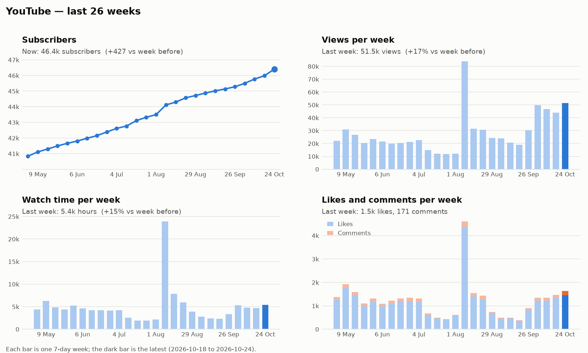
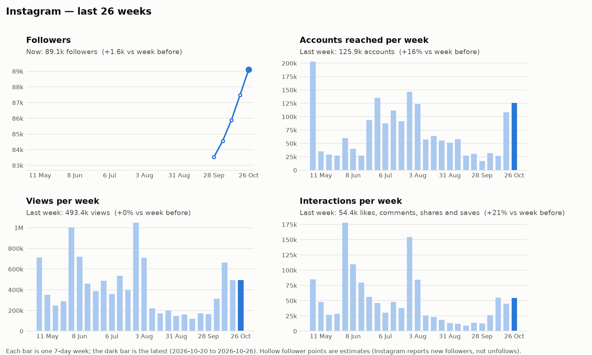

# Weekly Media Report — 2026-10-27

## YouTube

_Week of 18 Oct to 24 Oct._ Views rose 17% to 51.5k and we gained 427 subscribers, the best week since August. The France live stream did most of the work.

### New uploads

| Upload | Type | Posted | Views | Hours watched | Avg % watched | Likes | Comments | New subs |
|---|---|---|--:|--:|--:|--:|--:|--:|
| [Class War in the USA – Part Two](https://www.youtube.com/watch?v=1WymP2ULpMM) | Live | Tue 27 Oct | 148 | – | – | 49 | 1 | – |
| [Death to capitalism!](https://www.youtube.com/watch?v=S5DEltqIZzc) | Short | Fri 23 Oct | 1.4k | 8 | 75% | 244 | 28 | 0 |
| [France: What's REALLY happening](https://www.youtube.com/watch?v=qqM5441Rny0) | Live | Thu 22 Oct | 19.2k | 1.6k | 27% | 581 | 109 | +46 |

**Class War in the USA – Part Two**
- **Compared with usual:** too new to judge.

**Death to capitalism!**
- **Compared with usual:** about 21% fewer views than our Shorts usually have after 5 days. People watched about 19% more of it than usual.
- **Verdict:** Fewer people saw it than our typical Short, but most who did watched it to the end.
- **Comments:** Almost all short messages of solidarity and slogans.

**France: What's REALLY happening**
- **Compared with usual:** about 2× the views our live streams usually have after 5 days. People watched about 35% more of it than usual.
- **Verdict:** Our strongest upload of the week, and the main reason channel views went up.
- **Comments:** Viewers sent greetings from many countries, and several said what's missing is a party to lead. One wrote: "The movements are there, all we have to build is the leadership and the party."

### Trends

Subscribers have grown steadily for six months, from about 41k in May to 46.4k, and growth has been faster since late September. Weekly views have stayed between 44k and 52k for four weeks, roughly double the summer level. Only the one-off spike in early August was higher. Watch time and likes follow the same pattern.

- **Where views came from:** subscribers' feeds 58%, YouTube search 17%, suggested videos 6%.

## Instagram

_Week of 20 Oct to 26 Oct._ We reached 126k accounts, up 16% on the week before, and gained about 1.6k followers to reach 89.1k.

### New posts

| Post | Type | Posted | Reached | Views | Likes | Comments | Shares | Saves |
|---|---|---|--:|--:|--:|--:|--:|--:|
| [🇧🇷🚩 Mass mobilisations beat Bolsonaro.](https://www.instagram.com/reel/De90qw6x3Xk/) | Reel | Mon 26 Oct | 22.1k | 37.2k | 2.4k | 69 | 339 | 169 |
| [Europe was the birthplace of capitalism…](https://www.instagram.com/reel/De1d2pIPp4R/) | Reel | Fri 23 Oct | 32.4k | 48.5k | 4.3k | 91 | 979 | 468 |

**Mass mobilisations beat Bolsonaro**
- **Compared with usual:** too new to judge.
- **Comments:** Mostly messages of support in Portuguese from people in Brazil.

**Europe was the birthplace of capitalism**
- **Compared with usual:** about 2.5× the shares and about 2× the saves and likes of our usual Reel. Reach is about usual so far.
- **Verdict:** It reached a normal number of people, but far more of them shared and saved it than usual.
- **Comments:** Short messages of support, plus a few about the police protecting property.

### Trends

Reach and interactions have climbed back toward their summer highs after a quiet August and September. Weekly views have held near 500k for three weeks. Follower tracking started 27 Oct, so earlier points are estimates.

- **Older post picking up:** [this Reel](https://www.instagram.com/reel/Detx3w_RzUI/) got 85 more likes and comments.
