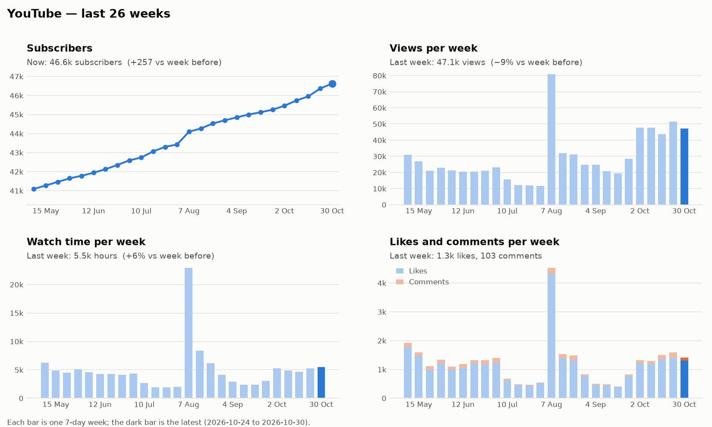
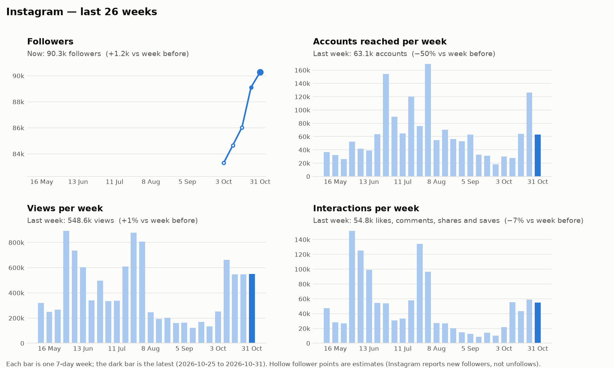

# Weekly Media Report — 2026-11-02

## YouTube

_Week of 24 Oct to 30 Oct._ Views fell 9% to 47.1k and we gained 257 subscribers net, down from 416 the week before. Watch time still rose 6% to 5.5k hours.

### New uploads

| Upload | Type | Posted | Views | Hours watched | Avg % watched | Likes | Comments | New subs |
|---|---|---|--:|--:|--:|--:|--:|--:|
| [Brazil, Serbia, Israel: Elections](https://www.youtube.com/watch?v=1ojIDvnMq-k) | Live | Thu 29 Oct | 7.7k | 874 | 26% | 347 | 61 | +8 |
| [Class War in the USA – Part Two](https://www.youtube.com/watch?v=1WymP2ULpMM) | Live | Tue 27 Oct | 8.5k | 1.0k | 16% | 273 | 27 | +15 |

**Brazil, Serbia, Israel: Elections**
- **Compared with usual:** about 35% fewer views than our live streams usually have after 4 days. People watched about 30% more of it than usual.
- **Verdict:** Fewer viewers than a typical episode, but they stayed longer than usual.
- **Comments:** Greetings and praise from Brazil, Serbia, Egypt and Russia, with several calls to build the party. One wrote: "This is why we need a revolutionary international of the working class."

**Class War in the USA – Part Two**
- **Compared with usual:** about 40% fewer views than usual after 6 days. People watched about 22% less of it than usual.
- **Verdict:** Our weakest upload of the week on both views and how far people got.
- **Comments:** Many said they had never heard this part of US labour history. One shared a family story: "My dad tried to organize the sailors on this aircraft carrier."

### Trends

Subscribers have climbed every week since May, from about 41k to 46.6k, and the slope has been steeper since late September. Weekly views have sat between 43k and 52k for five weeks, about double the summer level. Watch time has turned up over the last three weeks even as views levelled off.

- **Where views came from:** subscribers' feeds 55%, YouTube search 19%, suggested videos 6%.
- **Older video picking up:** [this video](https://www.youtube.com/watch?v=yJ-Sz-jpVPA) took 209 views this week after none last week.

## Instagram

_Week of 25 Oct to 31 Oct._ We reached 63.1k accounts, half of last week's 126k, but views held steady at 549k. Followers grew by about 1.2k to 90.3k.

### New posts

| Post | Type | Posted | Reached | Views | Likes | Comments | Shares | Saves |
|---|---|---|--:|--:|--:|--:|--:|--:|
| [24 October showed that the reserves…](https://www.instagram.com/reel/DfAfLL7RbxZ/) | Reel | Tue 27 Oct | 26.3k | 41.4k | 2.0k | 24 | 154 | 136 |
| [Mass mobilisations beat Bolsonaro](https://www.instagram.com/reel/De90qw6x3Xk/) | Reel | Mon 26 Oct | 29.7k | 48.7k | 2.9k | 103 | 437 | 202 |

**24 October showed that the reserves…**
- **Compared with usual:** about 23% less reach and 24% fewer likes than usual so far. Shares are about 67% lower and comments about 76% lower.
- **Verdict:** People watched it but passed it on far less than our other Reels, and it is still young.
- **Comments:** Mostly emoji and short messages of support, with a few French viewers tagging friends.

**Mass mobilisations beat Bolsonaro**
- **Compared with usual:** about usual on reach, views, likes, comments and shares. Saves are about 42% lower than usual.
- **Verdict:** A steady Reel that matched our normal Reel performance.
- **Comments:** Lots of Portuguese-language celebration from Brazil and several asking for a part two.

### Trends

Follower tracking started 2026-10-27, so earlier points are estimates. Views have held near 550k for four weeks, well above the 130k to 170k of September. Reach is the jumpy line, swinging between 18k and 126k over the same period, so this week's drop fits the usual pattern.

- **Older post picking up:** [this Reel](https://www.instagram.com/reel/De1d2pIPp4R/) added 766 likes and comments this week, and [this one](https://www.instagram.com/reel/Detx3w_RzUI/) added 255, both after none last week.
