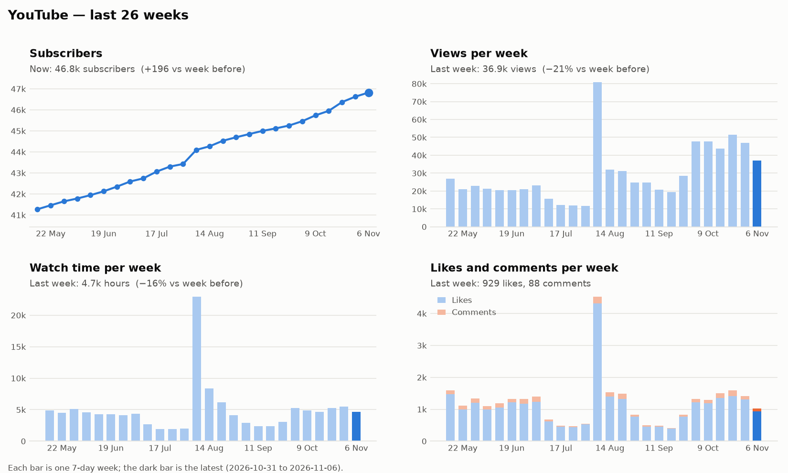
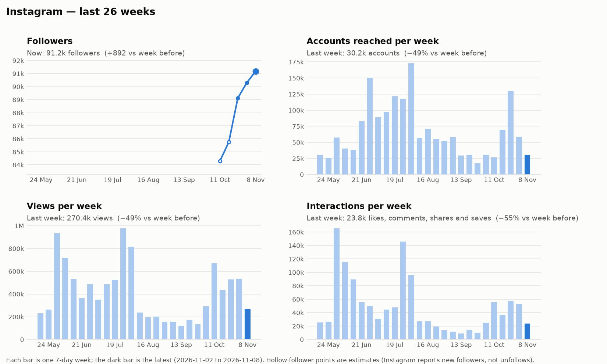

# Weekly Media Report — 2026-11-09

## YouTube

_Week of 31 Oct to 6 Nov._ Views fell 21% to 36.9k and we gained 196 subscribers net, down from 257 the week before. Watch time fell 16% to 4.7k hours after three stronger weeks.

### New uploads

| Upload | Type | Posted | Views | Hours watched | Avg % watched | Likes | Comments | New subs |
|---|---|---|--:|--:|--:|--:|--:|--:|
| [Trump's Midterm Meltdown](https://www.youtube.com/watch?v=xENHaDynB6c) | Live | Thu 5 Nov | 14.0k | 1.6k | 28% | 512 | 78 | +17 |

**Trump's Midterm Meltdown**
- **Compared with usual:** about 18% more views than our live streams usually have after 4 days. People watched about 40% more of it than usual.
- **Verdict:** Our one upload of the week did better than a typical episode on both views and how far people got.
- **Comments:** Greetings and praise from Cairo, Brazil and California, with many calls to build the party. One wrote: "You can't get the truth without a Marxist analysis."

### Trends

Subscribers have risen every week since May, from about 41k to 46.8k, and the climb has not slowed. Weekly views sat between 44k and 52k for five weeks, so this is the first week under 40k since late September. Watch time has come off its October high for a second week.

- **Where views came from:** subscribers' feeds 53%, YouTube search 22%, suggested videos 6%.

## Instagram

_Week of 2 Nov to 8 Nov._ We reached 30.2k accounts, about half of last week's 58.8k, and views fell 49% to 270k. Followers still grew by about 900 to 91.2k.

### New posts

| Post | Type | Posted | Reached | Views | Likes | Comments | Shares | Saves |
|---|---|---|--:|--:|--:|--:|--:|--:|
| [ITALY: Organise to bring the country…](https://www.instagram.com/reel/DfhWAFQvVmj/) | Reel | Mon 9 Nov | 8.1k | 14.0k | 1.2k | 18 | 174 | 76 |
| [INTRODUCING THE NEW MARXIST.COM!](https://www.instagram.com/reel/DfaO3BlRUaC/) | Reel | Fri 6 Nov | 11.0k | 21.9k | 1.4k | 55 | 248 | 55 |

**ITALY: Organise to bring the country…**
- **Compared with usual:** too new to judge. It went up a few hours ago.
- **Verdict:** Early numbers only, so there is no verdict yet.
- **Comments:** Emoji and revolutionary greetings from Italy, Brazil and the former Yugoslavia. One wrote: "Workers of the world unite!"

**INTRODUCING THE NEW MARXIST.COM!**
- **Compared with usual:** about 64% less reach and about 57% fewer views than usual so far. Saves are about 85% lower and shares about 48% lower.
- **Verdict:** Three days in, it sits well below our usual Reel on every count, and it is still young.
- **Comments:** Warm reactions to the redesign, with dark mode, the search and the e-reader named most. Several asked for a save-for-later feature and an app. One wrote: "the search engine is incredible".

### Trends

Follower tracking started 2026-10-27, so earlier points are estimates. Views peaked near 671k in early October and have fallen for three weeks running to 270k. Reach has swung between 17k and 129k since September, so this week's 30.2k sits inside the normal band.

- **Older post picking up:** [this Reel](https://www.instagram.com/reel/DfAfLL7RbxZ/) added 227 likes and comments this week, and [this one](https://www.instagram.com/reel/De90qw6x3Xk/) added 165, both after none last week.
