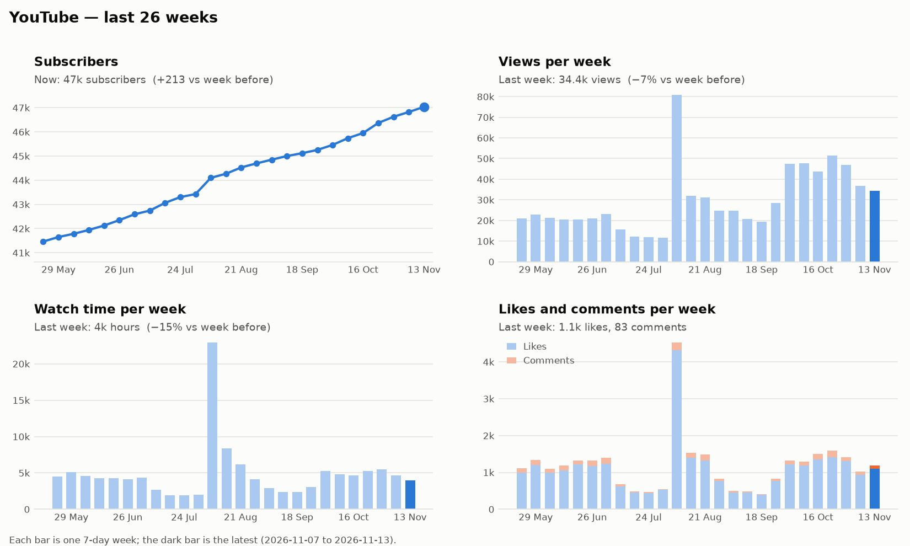
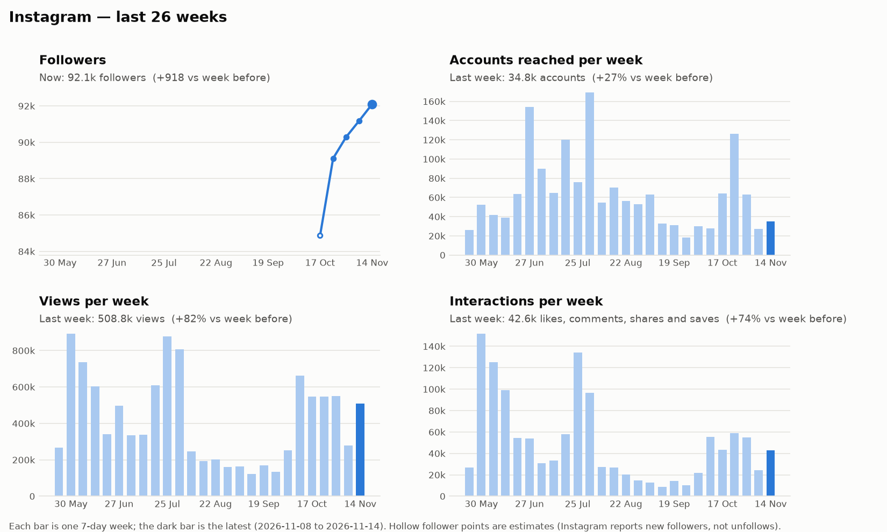

# Weekly Media Report — 2026-11-15

## YouTube

_Week of 7 Nov to 13 Nov._ Views fell 7% to 34.4k, the lowest week since mid-September, and watch time fell 15% to 4.0k hours. We gained 213 subscribers net, up from 196, taking us to 47.0k.

### New uploads

| Upload | Type | Posted | Views | Hours watched | Avg % watched | Likes | Comments | New subs |
|---|---|---|--:|--:|--:|--:|--:|--:|
| [What Trump's defeat means for US…](https://www.youtube.com/watch?v=LCibQVrK0IE) | Live | Thu 12 Nov | 6.6k | 917 | 30% | 323 | 38 | +8 |
| [Marx or Trump – who makes more sense?](https://www.youtube.com/watch?v=E2fKnzTnmqk) | Short | Tue 10 Nov | 3.1k | 18 | 81% | 243 | 13 | +1 |

**What Trump's defeat means for US…**
- **Compared with usual:** about 52% fewer views than our live streams get by day four. People watched about 48% more of it than usual.
- **Verdict:** Fewer people came, but those who did stayed much longer than they do on a typical stream.
- **Comments:** Praise for the hosting and a few long questions on the midterms and Iran, plus one critic. One wrote: "Absolute treasure trove of analysis and information."

**Marx or Trump – who makes more sense?**
- **Compared with usual:** about 1.5× our usual Short views at the same age, and about 27% more of it watched than usual.
- **Verdict:** Our strongest upload of the week on both views and how far people got.
- **Comments:** Most joked that Trump is doing our recruiting for us. One wrote: "no one promotes the rci like trump!"

### Trends

Subscribers have gone up every week since May, from about 41.5k to 47.0k, and that climb has not slowed. Weekly views have now fallen two weeks in a row from the October run of 44k to 52k. Watch time has come down with them, from 5.5k hours in late October to 4.0k.

- **Where views came from:** subscribers' feeds 45%, YouTube search 24%, suggested videos 6%.

## Instagram

_Week of 8 Nov to 14 Nov._ We reached 34.8k accounts, up 27%, and views rose 82% to 509k off one new post. Followers grew by about 900 to 92.1k.

### New posts

| Post | Type | Posted | Reached | Views | Likes | Comments | Shares | Saves |
|---|---|---|--:|--:|--:|--:|--:|--:|
| [ITALY: Organise to bring the country…](https://www.instagram.com/reel/DfhWAFQvVmj/) | Reel | Mon 9 Nov | 23.4k | 39.0k | 2.6k | 119 | 594 | 177 |

**ITALY: Organise to bring the country…**
- **Compared with usual:** about 24% less reach and about 24% fewer views than usual so far. Shares are about 25% higher, saves about 50% lower, likes and comments about usual.
- **Verdict:** Six days in it trails our usual Reel on reach, but people share it more than most.
- **Comments:** Revolutionary greetings in Italian, Portuguese and English, many from Italy itself. One wrote: "A spectre is haunting Europe".

### Trends

Follower tracking started 2026-10-27, so earlier points are estimates. Views bounced back to 509k after a dip to 280k, but stay below the 546k to 662k run of October. Reach has swung between 17k and 126k since September, and this week's 34.8k sits in the lower half of that band.

- **Older post picking up:** [this Reel](https://www.instagram.com/reel/DfaO3BlRUaC/) added 78 likes and comments this week, after none last week.
